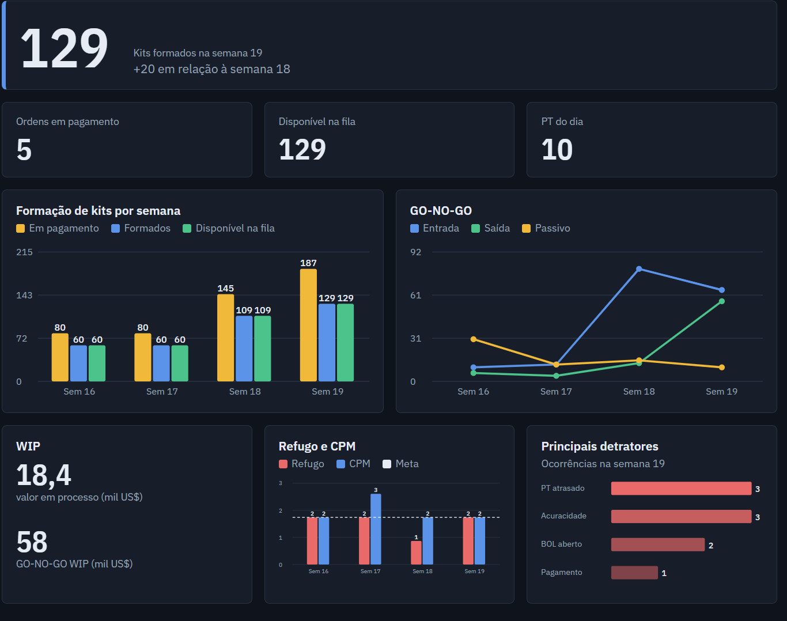

# Dashboard de Gestão Logística

Dashboard para acompanhamento semanal de operações logísticas: formação de
kits, WIP, GO-NO-GO, refugo, CPM e principais detratores.

Este é um projeto de portfólio com **dados fictícios**, inspirado em um
dashboard em Power BI que desenvolvi em ambiente industrial.

## Problema
O acompanhamento era feito manualmente, em várias planilhas.

## Solução
Dashboard com atualização automática a partir de planilhas Excel,
reunindo todos os indicadores em uma única tela.

## Indicadores
- Kits formados e disponíveis na fila
- WIP e GO-NO-GO
- Refugo e CPM versus meta
- Principais detratores

## Tecnologias
Power BI, Excel, DAX, Power Query

> Todos os dados são fictícios.
